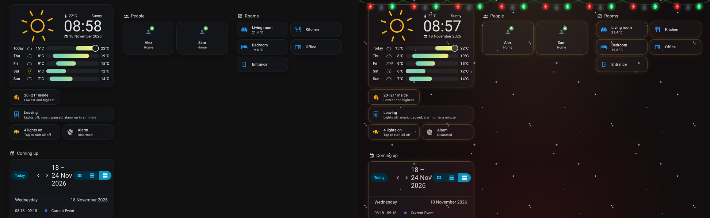

# Festive Panel for Home Assistant

Make your Home Assistant dashboards feel like the holidays — **falling snow, a string of blinking lights and a warm glow** over the whole screen, a **Christmas countdown card**, a **festive theme**, and a **blueprint that runs the tree lights** for you.

Built for wall-mounted tablets, but it works on any dashboard, phone or desktop.

On a wall tablet, it sits on top of whatever dashboard you use, for example [Wall Panel Kit](https://github.com/davidteles/ha-wall-panel-kit), the dashboard you touch, or under [Glass Info](https://github.com/davidteles/ks-glass-info), what the tablet shows while idle. Tested with Home Assistant **2026.11.2**.



<sub>Before and after on a sample home (Home Assistant's demo devices, made-up people). The snow and lights move; this is a still.</sub>

## The quick win: just the snow (2 minutes, nothing else to install)

1. Install **Festive Overlay Card** ([with HACS or by hand](#install)) and reload the browser.
2. Edit a dashboard, add a **Manual** card and paste:
   ```yaml
   type: custom:festive-overlay-card
   ```
3. Save. Snow, string lights and a warm glow appear over the whole view; your taps still reach the cards underneath.

That's the whole overlay: no Mushroom, no card-mod, no helpers. **To remove it,** delete that card (and, if you like, uninstall the card in HACS). Everything below is optional and independent.

| If you want… | Add | Needs |
|---|---|---|
| The overlay only while the tree is on, or only in December | [`entity` / `season` options](#use) | Nothing else |
| An Auto / On / Off switch for the family | [Two helpers](#auto--on--off-switch) | Nothing else |
| The tree to switch itself on and off | [Tree schedule blueprint](#festive-tree-schedule-blueprint) | Home Assistant 2025.1+ |
| A countdown card | [Countdown example](#christmas-countdown-card) | Mushroom, card-mod |
| Red-and-gold colours | [Festive theme](#festive-theme) | Nothing else |

---

## Festive overlay card

A pure-CSS overlay: no images, no JavaScript animation loop, so it is light enough for an old tablet. It sits behind your taps (`pointer-events: none`), and it respects the system's **Reduce motion** setting.

### Install

**With HACS:**

1. HACS → ⋮ → **Custom repositories** → add `https://github.com/davidteles/ha-festive-panel` as **Dashboard**.
2. Install **Festive Overlay Card**, then reload the browser.

**By hand:**

1. Copy `dist/festive-overlay-card.js` to `config/www/festive-overlay-card.js`.
2. Settings → Dashboards → ⋮ → **Resources** → add `/local/festive-overlay-card.js` as a **JavaScript module**.
3. Reload the browser.

### Use

Add a card anywhere on a view (the first section is a good place). While you edit the dashboard it shows as a small "❄️ Festive overlay" card so you can find it; otherwise it takes no space.

```yaml
# Show everything while the tree is on
type: custom:festive-overlay-card
entity: light.christmas_tree
```

```yaml
# Only snow, every day from 1 December to 6 January
type: custom:festive-overlay-card
effects: [snow]
season:
  from: "12-01"
  to: "01-06"
```

### Auto / On / Off switch

Let anyone in the house choose: **Auto** follows the tree light, **On** shows the effects all the time, **Off** never. Add the two helpers from [`examples/festive-mode-package.yaml`](examples/festive-mode-package.yaml) (a package, or the same settings in the UI), then point the card at the result:

```yaml
type: custom:festive-overlay-card
entity: binary_sensor.festive_mode_active
```

Put the selector anywhere on the dashboard, for example as a tile:

```yaml
type: tile
entity: input_select.festive_mode
features:
  - type: select-options
```

Want it on every page? Add the card to each view — or to one view and use it as your festive "home".

### Options

| Option | Default | Description |
|---|---|---|
| `effects` | `[snow, lights, glow]` | Any of `snow`, `lights` (string lights along the top), `glow` (gold from the top, red from the bottom). |
| `entity` | — | Only show while this entity is in `state`. Leave out to always show (within the season). |
| `state` | `on` | The state (or list of states) that shows the overlay. |
| `season` | — | `from` / `to` as `MM-DD`. The window may cross the new year (`12-01` → `01-06`). |
| `snow` | `normal` | `light`, `normal` or `heavy`. |
| `lights_top` | auto | Where the string lights hang, in pixels from the top. By default they sit just below the dashboard header, or at the very top when the header is hidden (kiosk mode). |
| `z_index` | `3` | Raise it if a card covers the snow, lower it (or `-1`) to keep the snow behind cards. |
| `respect_reduced_motion` | `true` | Stops the animations when the device asks for reduced motion. |

Both conditions must hold when you use `entity` and `season` together.

---

## Festive tree schedule (blueprint)

[](https://my.home-assistant.io/redirect/blueprint_import/?blueprint_url=https%3A%2F%2Fgithub.com%2Fdavidteles%2Fha-festive-panel%2Fblob%2Fmain%2Fblueprints%2Fautomation%2Ffestive_tree_schedule.yaml)

What it does:

- **Before sunset** (15 minutes by default) the tree comes on — only if someone is home, so an empty house stays dark.
- **Someone arrives** between then and midnight → on.
- **Everyone leaves** → off.
- **Every night** at the switch-off time (midnight by default) → off, **except the late nights** you list (`12-24, 12-25, 12-31` by default — the date of the *evening*, so it stays on into the 25th, the 26th and New Year's Day).
- While the tree is **unplugged** (`unavailable`) it does nothing, so you can leave the automation on all year.

Inputs: the tree (light or switch), the home zone, the people whose arrival counts, the sunset offset, the switch-off time and the late nights.

> If you pick a switch-off time after midnight (for example 01:00), arrivals after midnight don't switch the tree back on.

---

## Christmas countdown card

[`examples/countdown-card.yaml`](examples/countdown-card.yaml) — a Mushroom template card that shows:

- *"23 days to Christmas · tap to light it"* in November and December,
- *"Christmas Eve! 🎅"* and *"Merry Christmas! 🎄"* on the day, with the festive glow even if the tree is off,
- *"Happy holidays"* until the 31st and *"Happy New Year"* until 10 January.

While the tree is on, the card gets a red-and-green gradient, a gold border and a gently swaying, twinkling tree icon.

Needs [Mushroom](https://github.com/piitaya/lovelace-mushroom) and [card-mod](https://github.com/thomasloven/lovelace-card-mod). Replace `light.christmas_tree` with your own light.

> **Tip:** if your tree is a smart plug or light that disappears when unplugged, hide the card with a [visibility condition](https://www.home-assistant.io/dashboards/cards/#showing-or-hiding-a-card-conditionally) on its state not being `unavailable`.

---

## Festive theme

[`themes/festive.yaml`](themes/festive.yaml) — deep red primary, gold accent and a warm header. Copy it into your `themes` folder, run **Reload themes** (Developer tools → Actions → `frontend.reload_themes`) and pick **Festive** in your profile.

Switch to it automatically while the tree is on:

```yaml
- trigger: state
  entity_id: light.christmas_tree
actions:
  - action: frontend.set_theme
    data:
      name: "{{ 'Festive' if trigger.to_state.state == 'on' else 'default' }}"
```

---

## Remove it

Each piece comes off on its own:

- **Overlay:** delete the card from each view. To remove the code too, uninstall *Festive Overlay Card* in HACS (or delete `www/festive-overlay-card.js` and its entry under Dashboards → ⋮ → Resources) and reload the browser.
- **Auto / On / Off:** delete the two helpers (or the package file) and point any remaining overlay card back at your tree, or at nothing.
- **Tree schedule:** delete or disable the automation; the blueprint itself can stay.
- **Countdown card and theme:** delete the card; pick another theme in your profile.

## Testing

`node tests/card.test.js` checks the overlay card without a browser (season across the new year, taps passing through, reduced motion, edit mode, entity states, config errors). It runs on every change. What needs a real dashboard or tree is in [tests/CHECKLIST.md](tests/CHECKLIST.md).

## Ideas and contributions

Issues and pull requests are welcome — see [CONTRIBUTING.md](CONTRIBUTING.md). Ideas on the list: more effects (stars, confetti for New Year), a visual editor for the card, and other seasons.


## License

[MIT](LICENSE)
